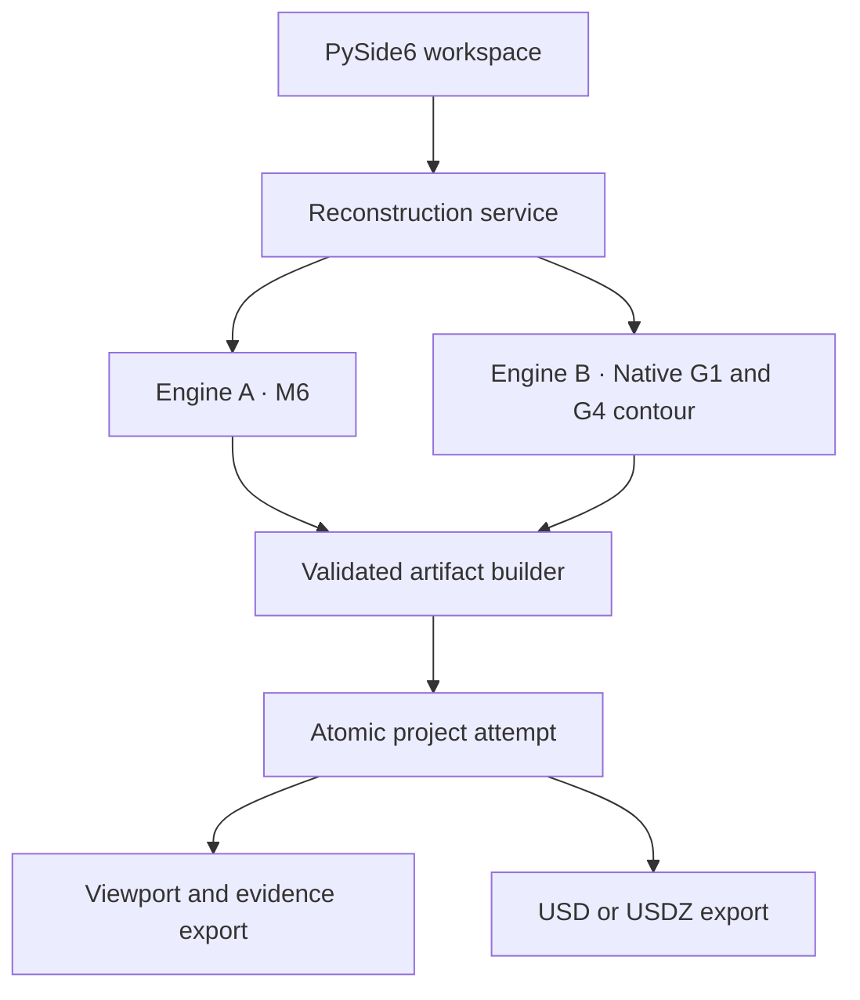

# M7 desktop architecture

The existing PySide6 application now opens the empirical workspace by default. Import owns project originals through the M6 ingestion layer. Selecting a thumbnail updates the target in the same project. Generate 3D snapshots that project and dispatches a single reconstruction service request in a Qt worker.

The immutable request includes the reference set and target, engine and app revision, optional garment, calibration reference and timestamp. Progress reports real stage transitions. The service builds each attempt in a staging directory and checks the project snapshot again under the existing writer lock before publishing. Cancelled, stale and failed attempts contain diagnostics and leave prior complete artifacts accessible. A detector subprocess observes the cancellation token and can stop inside inference. Native stages stop at supported checkpoints.

The M6 shared fit reuses the existing observation dependency digest. Engine B identifies its canonical cache by the same evidence digest, calibration content hash and application revision. Target selection is excluded from both fitting identities. The target controls articulation and appears in distinct result metadata. Each complete attempt stores canonical and optional posed USD or USDZ plus a rendering packet and optional overlay. Export copies the validated asset atomically and checks its digest.
